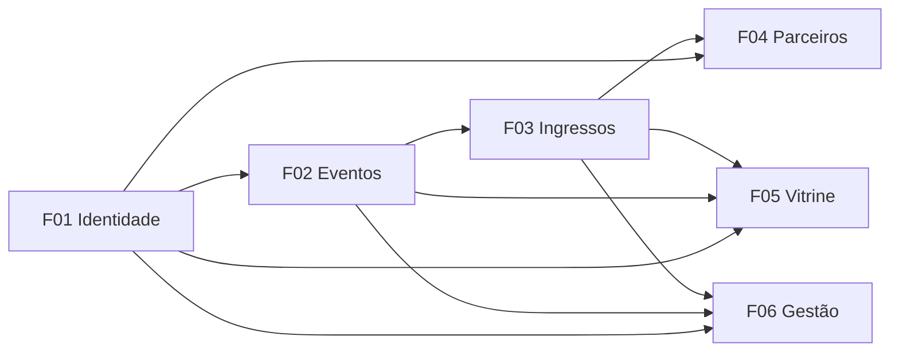

# PRD — Catraca

A Catraca vende um ingresso por vez para eventos pequenos. Este PRD quebra o brief (regras R01–R13) em features com dependências explícitas. O que uma feature diz que provê precisa funcionar na feature que consome.

## Problema

Shows em bar, workshops e meetups esgotam, estornam e fazem check-in ao mesmo tempo. Uma compra que funciona sozinha não basta: evento cancelado não pode deixar gente entrar, estorno não pode entrar na receita, e a lotação não pode estourar quando trinta pessoas compram juntas.

## Quem usa

- **Visitante:** sem conta, vê a vitrine.
- **Participante:** cria a própria conta (nome, e-mail e senha), entra, sai, compra e vê os próprios ingressos.
- **Organizador:** não se cadastra pelo produto. As contas vêm da seed. Cria e opera os próprios eventos.
- **Parceiro:** sistema externo. Vende pela API com `X-Api-Key`.

## Fora de escopo

- Deploy e qualquer ambiente além do local.
- Gateway de pagamento real, e-mail e notificações.
- App mobile e qualidade visual. Nenhum critério avalia design.
- Cadastro de organizador pelo produto.
- Mais de um ingresso por compra, mapa de assentos, cancelamento ou transferência de ingresso pelo participante.
- Atualização em tempo real. Recarregar a página basta para ver o status novo.
- Fuso além de America/Sao_Paulo. O fluxo usa datas com folga de pelo menos um dia.

## Features

### F01 — Identidade e acesso

**Provê:** cadastro de participante, login, logout, sessão em cookie, contas de organizador e chave de parceiro da seed, guarda que distingue participante de organizador.

**Consome:** nada.

**Critérios**

- **F01-AC1.** Participante cria conta com nome, e-mail e senha, entra e sai. A sessão usada antes do logout deixa de abrir a área logada.
- **F01-AC2.** Organizador entra com a conta da seed. O cadastro do produto só cria participante; e-mail já usado é recusado. (R13)
- **F01-AC3.** Visitante sem sessão é enviado ao login ao abrir a área do organizador e a resposta não traz dado de evento. (R13)

### F02 — Eventos

**Provê:** evento com nome, início, local, lotação e preço; estados rascunho, publicado e cancelado; criar, editar e publicar; listagem à venda; página de gestão por URL.

**Consome:** F01 (sessão de organizador).

**Critérios**

- **F02-AC1.** Criar ou editar exige nome, local, lotação inteira mínima 1, preço maior que zero e início no futuro. Data passada é rejeitada e o evento não muda. (R01)
- **F02-AC2.** Todo evento nasce rascunho. Rascunho não entra na listagem à venda. Publicar é explícito. (R02)
- **F02-AC3.** Lotação não fica abaixo das vagas ocupadas. Aumentar lotação e mudar o preço é aceito. O preço novo não reescreve compra antiga. (R03)
- **F02-AC4.** Cada evento tem a URL `/organizador/eventos/{id}`. A lista do organizador só traz os eventos dele. (R04, R13)

### F03 — Ingressos, vagas e gateway

**Provê:** compra de um ingresso, ocupação, código único, gateway simulado, liquidação no cancelamento, check-in e agregados do painel.

**Consome:** F02 (evento publicado, preço e lotação vigentes).

**Critérios**

- **F03-AC1.** Vagas ocupadas são ingressos `pending` mais `confirmed`. Disponíveis são a lotação menos as ocupadas. Evento cancelado tem zero disponíveis. (R05)
- **F03-AC2.** A compra nasce `pending`, já ocupa vaga e retorna sem esperar o gateway. (R06)
- **F03-AC3.** Sem vaga a compra é recusada e não cria ingresso. Em lotação 5, 30 compras simultâneas produzem 5 sucesso e 25 `sold_out`, repetido em eventos novos. (R07)
- **F03-AC4.** Cartão final 0001 ou 0003 aprova; 0002, 0004 ou qualquer outro recusa. Aprovado vira `confirmed`. Recusado vira `declined` e libera a vaga. Cartão que não tem 16 dígitos não cria ingresso. O atraso rápido fica entre 2 e 5 segundos e o lento entre 30 e 40. (R08)
- **F03-AC5.** Cada ingresso tem código único, usado no check-in. (R09)
- **F03-AC6.** Cancelar evento publicado passa `confirmed` a `refunded` e `pending` a `cancelled`. Resposta do gateway que chega depois não muda esses status, e o evento deixa de aceitar compra. (R11)
- **F03-AC7.** O check-in obedece a primeira condição verdadeira: código inexistente ou de outro evento, evento cancelado, ingresso não confirmado, já utilizado, entrada liberada. (R10)
- **F03-AC8.** O painel conta confirmados (inclusive quem já entrou), pendentes, check-ins, vagas, receita pelo preço gravado em cada compra confirmada, e estornados. (R12)

### F04 — API de parceiros

**Provê:** `GET /api/partner/events`, `POST /api/partner/events/{eventId}/purchases` e `GET /api/partner/tickets/{ticketId}` no contrato fixo do brief.

**Consome:** F01 (chave de parceiro) e F03 (listagem à venda, compra e consulta). A listagem à venda é a de F02, exposta por F03.

**Critérios**

- **F04-AC1.** A listagem devolve só eventos publicados e não cancelados, com `id`, `name`, `startsAt`, `priceCents` e `availableSeats`. (R02, R05)
- **F04-AC2.** A compra responde 202 com `ticketId`, `code` e `status: pending`. Depois da chave, a ordem dos erros é 422 `invalid_request`, 404 `event_not_available`, 409 `sold_out`.
- **F04-AC3.** A consulta devolve `ticketId`, `code`, `eventId`, `status` e `checkedIn`. Ingresso inexistente é 404 `ticket_not_found`.
- **F04-AC4.** Sem chave ou com chave inválida, as três rotas respondem 401 `{"error":"unauthorized"}`, mesmo se o corpo for inválido.

### F05 — Vitrine e meus ingressos

**Provê:** vitrine pública, página do evento, compra do participante e "Meus ingressos".

**Consome:** F01 (sessão de participante), F02 (o que está à venda) e F03 (compra e ingressos do participante).

**Critérios**

- **F05-AC1.** Visitante vê só evento publicado e não cancelado. Rascunho e cancelado não aparecem e a página direta não revela o nome. (R02)
- **F05-AC2.** A compra na vitrine nasce pendente, aparece em "Meus ingressos" com evento, status e código, e com o cartão final 0001 fica confirmada. O rótulo é pendente ou confirmado, não o valor cru da API. (R06, R08, R09)
- **F05-AC3.** Sem vaga, a vitrine exibe "Ingressos esgotados" no lugar da compra e também como resposta a uma nova tentativa. (R07)

### F06 — Gestão do organizador

**Provê:** na URL do evento, edição, publicação, painel, check-in e cancelamento.

**Consome:** F01 (papel de organizador), F02 (evento e edição) e F03 (painel, check-in e liquidação).

**Critérios**

- **F06-AC1.** A página de gestão mostra painel, check-in, edição e, se publicado, o cancelamento. Rascunho oferece publicar. (R04)
- **F06-AC2.** O check-in na página exibe o texto exato de cada situação de R10. (R10)
- **F06-AC3.** Cancelar é irreversível: a página deixa de editar e de publicar, confirmados viram estornados, pendentes viram cancelados, e o gateway tardio não reverte. (R11)
- **F06-AC4.** Os seis números do painel aparecem na página e batem com o preço vigente de cada compra. (R12)
- **F06-AC5.** Outro organizador não vê o evento na lista nem no endereço direto. Participante e visitante também não veem nome, número ou código. (R13)

## Grafo

F04 também lê a listagem à venda definida por F02 e servida pelo domínio de F03. A aresta F04→F02 está nos critérios XF-04.

## Waves

| Wave | Features | Modo |
| --- | --- | --- |
| 1 | F01 | sequencial |
| 2 | F02 | sequencial, depois de F01 |
| 3 | F03 | sequencial, depois de F02 |
| 4 | F04, F05, F06 | paralela, cada uma na própria branch |

A wave 4 não tem dependência interna. As três features só se encontram no merge.

## Critérios cross-feature

Cada aresta do grafo tem um critério que prova que o que uma feature provê chega na outra.

- **XF-01.** F02 consome F01. Participante autenticado não cria evento e não abre a gestão. (R13)
- **XF-02.** F03 consome F02. Compra só existe em evento publicado e não cancelado. O preço gravado no ingresso é o vigente naquela compra, não um preço alterado depois. (R02, R03)
- **XF-03.** F04 consome F01. As três rotas usam a chave da seed. Sem ela, ou com outra, a resposta é 401 `unauthorized` antes de qualquer outro erro.
- **XF-04.** F04 consome F02. Rascunho fica fora da listagem e a compra responde `event_not_available`. O mesmo vale depois do cancelamento. (R02, R11)
- **XF-05.** F04 consome F03. O POST cria `pending`, ocupa vaga e o GET devolve o mesmo status que o domínio guarda depois do gateway. (R05, R06, R08)
- **XF-06.** F05 consome F01. Visitante vê a vitrine. Comprar sem sessão redireciona ao login e não cria ingresso.
- **XF-07.** F05 consome F02. Rascunho não aparece na vitrine. Publicado aparece. Cancelado sai. (R02)
- **XF-08.** F05 consome F03. "Meus ingressos" mostra o evento, o rótulo e o código gravados na compra, e acompanha a confirmação do gateway. (R06, R08, R09)
- **XF-09.** F06 consome F01. Participante e visitante, no endereço direto da gestão, não recebem nome, número nem código do evento. (R13)
- **XF-10.** F06 consome F02. Editar na gestão rejeita início no passado e lotação inválida, e aceita lotação igual às vagas ocupadas. (R01, R03)
- **XF-11.** F06 consome F03. Painel, check-in e cancelamento da página refletem os ingressos, inclusive os criados pelo domínio da compra. O gateway tardio não desfaz o cancelamento. (R10, R11, R12)

## Rastreio das regras

| Regra | Critérios |
| --- | --- |
| R01 | F02-AC1, XF-10 |
| R02 | F02-AC2, XF-02, XF-04, XF-07, F04-AC1, F05-AC1 |
| R03 | F02-AC3, XF-02, XF-10 |
| R04 | F02-AC4, F06-AC1 |
| R05 | F03-AC1, F04-AC1, XF-05 |
| R06 | F03-AC2, F05-AC2, XF-05, XF-08 |
| R07 | F03-AC3, F05-AC3 |
| R08 | F03-AC4, XF-05, XF-08, F05-AC2 |
| R09 | F03-AC5, F05-AC2, XF-08 |
| R10 | F03-AC7, F06-AC2, XF-11 |
| R11 | F03-AC6, F06-AC3, XF-04, XF-11 |
| R12 | F03-AC8, F06-AC4, XF-11 |
| R13 | F01-AC2, F01-AC3, F02-AC4, F06-AC5, XF-01, XF-09 |
